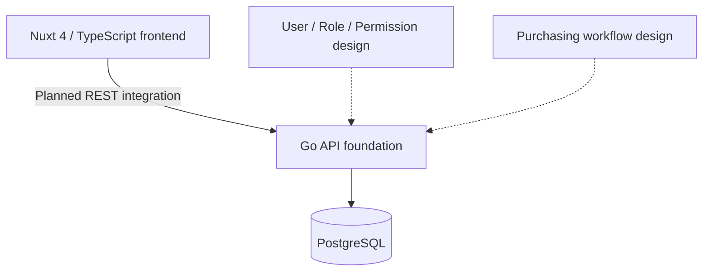
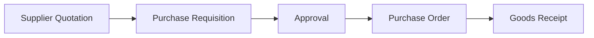

# ERP-NEW
### Modern Business ERP · Full Stack Personal Project

> An in-progress ERP application exploring business workflows, modular architecture, access control, and database design.


**ERP-NEW** is a personal software engineering project for designing an ERP system with a modern web interface and clearly separated application layers. The project focuses on the foundations of **user management**, **role-based permissions**, and **procurement workflows**—from purchase requests to goods receipt.

**Current maturity:** UI prototypes, architectural documentation, an initial Go API foundation, and a PostgreSQL User Module migration are present in this repository. Full authentication, purchasing operations, and production deployment are **not yet complete or verified**.

---

## Project overview

| Area | Scope | Current state |
| --- | --- | --- |
| Web UI | Login, navigation, dashboard, business screens | Initial UI and sample dashboard data; login is mocked |
| API foundation | Go HTTP service with Chi and PostgreSQL connectivity | Foundation and placeholder endpoints |
| User foundation | Companies, users, roles, permissions | SQL migration present; application integration in progress |
| Purchasing | Supplier quotation → PR → approval → PO → GR | Requirements, statuses, database design, migration plan |
| Security design | Authorization, multi-company isolation, audit history | Documented design goals; **not** production security claims |
| Reports | Purchasing overview, status KPIs, recent documents | Dashboard presentation with placeholder values |

## Technology stack

| Layer | Tools |
| --- | --- |
| Frontend | Nuxt 4, Vue, TypeScript, Nuxt UI, Tailwind CSS, i18n |
| Backend | Go, Chi router, pgx |
| Database | PostgreSQL |
| Design & workflow | Markdown specifications, process mapping, SQL migration drafts |
| Tooling | pnpm, Git |

## Architecture



The application is organized to keep presentation, HTTP/business logic, and persistence concerns separate. The diagram illustrates the **intended integration**, not a claim that every module is implemented.

## Purchasing workflow — design scope



The design documents address:

- Document status transitions, approvals, rejection and cancellation
- Partial PR → PO conversion and partial PO → GR receiving
- Quantity validation, transactions and audit history
- Multi-company organization and reusable role/permission concepts

These are **requirements and design decisions**, not a statement that the complete workflow is executable today.

## Repository structure

```text
ERP-NEW/
├── frontend/                 # Nuxt UI application and dashboard prototype
├── backend/                  # Go API foundation and SQL migrations
│   ├── cmd/api/
│   ├── internal/
│   └── migrations/
├── docs/                     # UI, architecture, user and purchasing specifications
└── setup_erp_new_backend.sh  # Backend setup helper
```

## Documentation

| Document | What it covers |
| --- | --- |
| [ERP Dashboard UI Spec](docs/ERP-NEW_DASHBOARD_UI_SPEC.md) | Application layout and dashboard design |
| [Frontend Structure](docs/ERP-NEW_FRONTEND_STRUCTURE.md) | UI architecture, routing, mock login, permission-based navigation direction |
| [User Module 1.0](docs/USER_MODULE_1.0.md) | Companies, users, roles, permissions and audit design |
| [Purchasing Status & Workflow](docs/Purchasing_Status_Workflow.md) | PR, PO, GR statuses and transition rules |
| [Purchasing Core Schema](docs/Purchasing_1.0_Core_Schema.md) | Database objects and business logic boundaries |
| [Purchasing Migration Plan](docs/Purchasing_1.0_Migration_Plan.md) | Planned rollout of purchasing tables and related objects |
| [Backend README](backend/README.md) | Go service setup and placeholder endpoints |
| [Frontend README](frontend/README.md) | Nuxt starter and local development notes |

## Development setup

### Frontend

```bash
cd frontend
pnpm install
pnpm dev
```

The frontend includes a **mock login** for UI development. Dashboard values currently include examples and should not be interpreted as live purchasing data.

### Backend

Use a **local, disposable PostgreSQL development database** and update your own environment variables before starting the service.

```bash
cd backend
cp .env.example .env
./scripts/dev.sh
```

See [backend/README.md](backend/README.md) for configuration and example endpoints. Sample responses in documentation do **not** demonstrate that a deployment or automated test has passed.

**Do not use production credentials, company data or sensitive personal information for this demo.**

## Engineering roadmap

- [x] Establish separate frontend and backend projects
- [x] Draft ERP dashboard and purchasing workflow specifications
- [x] Add Go API foundation and PostgreSQL configuration
- [x] Commit initial User Module SQL migration
- [ ] Replace mock login with authenticated sessions
- [ ] Connect frontend to backend and enforce server-side permissions
- [ ] Implement and validate end-to-end PR → PO → GR workflows
- [ ] Add automated tests and deployment hardening
- [ ] Perform a security review before any production release

---

### Portfolio context

This repository demonstrates **system analysis, architecture planning, frontend prototyping and backend/database foundations**. It is a work in progress and is not offered as a production-ready ERP system.

Other portfolio example: [Queue Management System](https://github.com/pongapla/Test_Kittiphob) · [GitHub profile](https://github.com/pongapla)

**Author:** Kittiphob Maynok
